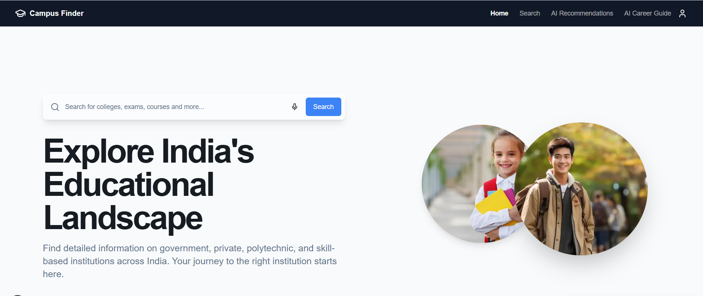
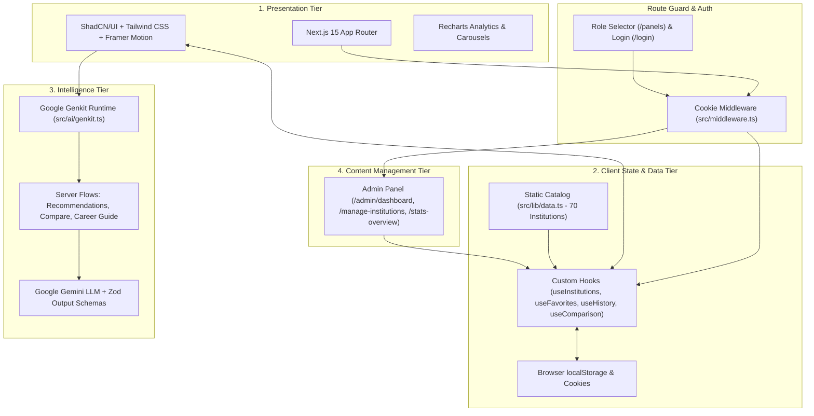
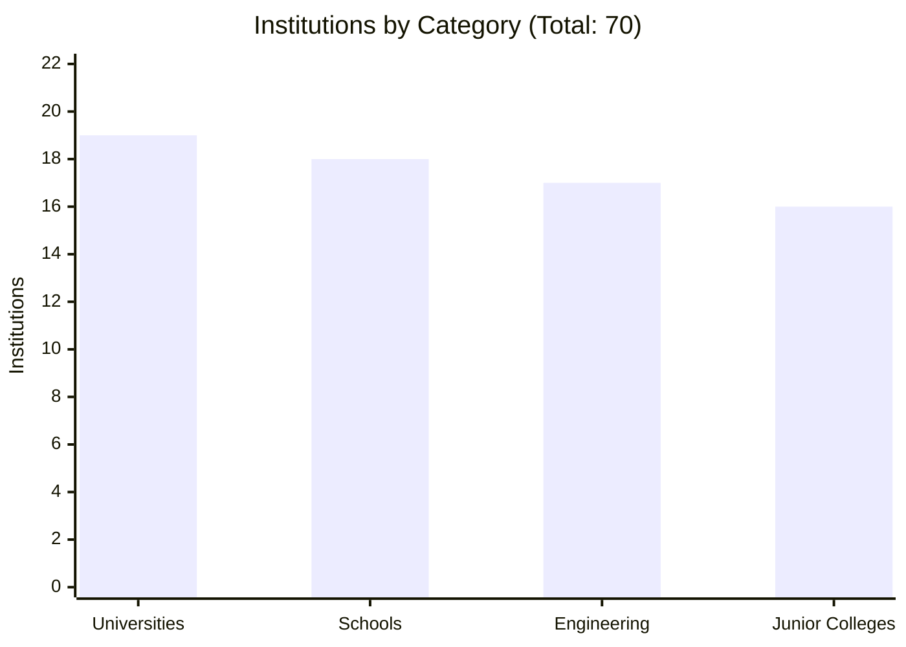
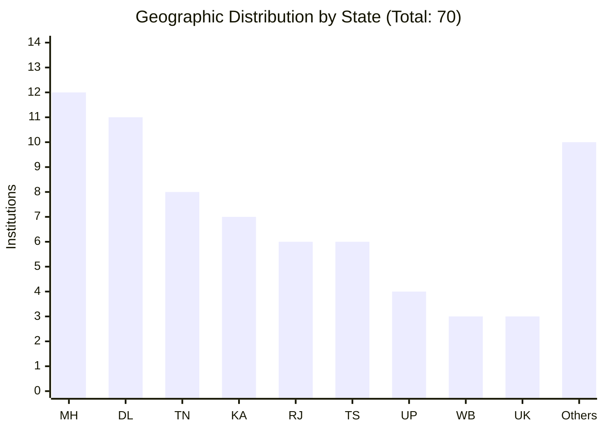
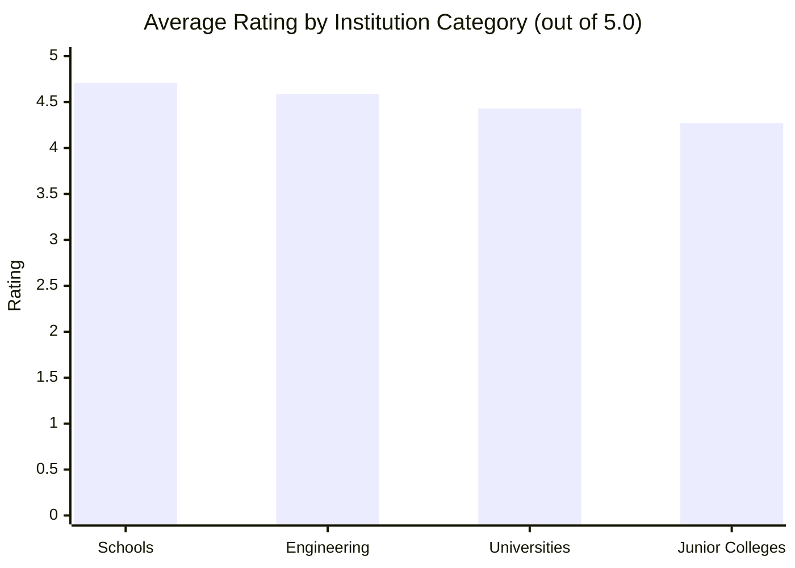
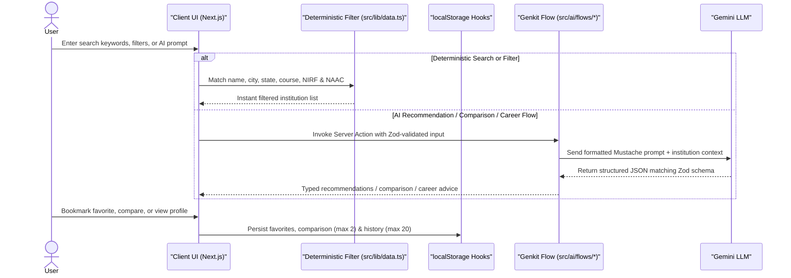
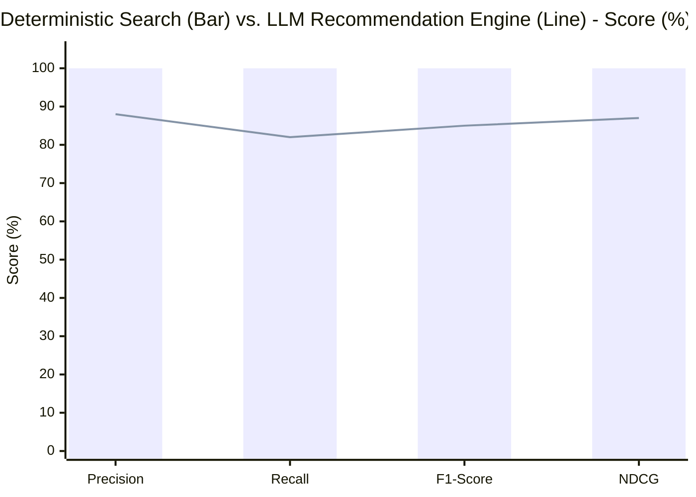
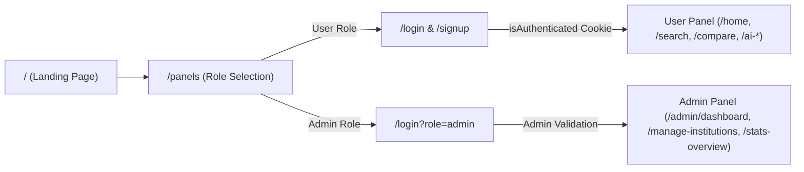

# Campus Finder


**Campus Finder** is a Next.js web application for discovering, filtering, and comparing educational institutions across India. It pairs a deterministic client-side search and filtering engine with Google Genkit / Gemini AI flows, personalized local persistence, and a role-gated Admin CMS.

---



---

## System Architecture

Campus Finder separates presentation, client-side state, route security, AI reasoning, and content administration into four decoupled tiers:



---

## Dataset Insights

The built-in catalog in [`src/lib/data.ts`](src/lib/data.ts) tracks **70 institutions** across **16 Indian states** and **35 cities**, covering **142 academic courses** with accreditation, placement, and infrastructure metadata.

### Catalog Summary

| Metric | Value | Details |
| :--- | :---: | :--- |
| **Total Institutions** | `70` | Balanced across 4 educational tiers |
| **States Covered** | `16` | Pan-India geographic representation |
| **Cities Covered** | `35` | Major metropolitan & educational hubs |
| **Cataloged Courses** | `142` | Includes duration, fees, eligibility & accepted exams |
| **NIRF-Ranked** | `36` | Official National Institutional Ranking Framework entries |
| **NAAC-Accredited** | `35` | `A++` (15), `A+` (8), `A` (12) |
| **Placement Profiles** | `36` | Average package, highest package & top recruiters |

### Category Breakdown

| Institution Type | Count | Dataset Share | Avg. Rating | Primary Coverage |
| :--- | :---: | :---: | :---: | :--- |
| **Universities** | `19` | `27.1%` | `4.43 / 5.0` | Central, state, deemed & private universities |
| **Schools** | `18` | `25.7%` | `4.71 / 5.0` | Kindergarten, primary & senior secondary schools |
| **Engineering Colleges** | `17` | `24.3%` | `4.59 / 5.0` | IITs, NITs, IIITs & state/private tech institutes |
| **Junior Colleges** | `16` | `22.9%` | `4.27 / 5.0` | Intermediate (Classes XI–XII) colleges |

### Interactive Dataset Charts

> *Tip: GitHub renders Mermaid diagrams interactively—use the hover controls on each chart to pan, zoom, and inspect values.*





> **State Codes**: `MH` Maharashtra (12), `DL` Delhi (11), `TN` Tamil Nadu (8), `KA` Karnataka (7), `RJ` Rajasthan (6), `TS` Telangana (6), `UP` Uttar Pradesh (4), `WB` West Bengal (3), `UK` Uttarakhand (3), `Others` AP, GJ, HR (2 each) & HP, KL, MP, PB (1 each).

<details>
<summary><strong>View Additional Interactive Charts & Accreditation Breakdown</strong></summary>



| NAAC Grade | Institution Count | Share of Total |
| :--- | :---: | :---: |
| **A++** | `15` | `21.4%` |
| **A+** | `8` | `11.4%` |
| **A** | `12` | `17.1%` |
| **N/A (Schools / Junior Colleges / Unlisted)** | `35` | `50.0%` |

</details>

---

## Key Features

### Student & Parent Discovery Panel

| Feature | Capabilities | Implementation |
| :--- | :--- | :--- |
| **Universal & Voice Search** | Keyword search across names, cities, and courses plus browser Web Speech API voice input | [`src/app/(main)/search/page.tsx`](src/app/%28main%29/search/page.tsx) |
| **Multi-Criteria Filtering** | Cascading filters by Institution Type, State, City, Course, **NIRF Ranking** (`Top 10/50/100`), and **NAAC Grade** (`A++` to `B+`) | [`src/app/(main)/search/page.tsx`](src/app/%28main%29/search/page.tsx) |
| **Institution Profiles** | Courses, fees, eligibility, exams, placements, campus infrastructure matrix, map links, photo gallery & user reviews | [`src/app/(main)/institution/[id]/institution-view.tsx`](src/app/%28main%29/institution/%5Bid%5D/institution-view.tsx) |
| **Side-by-Side Comparison** | Compare up to **2** institutions across placements, NIRF rank, NAAC grade, rating & facilities with 1–10 scoring | [`src/app/(main)/compare/page.tsx`](src/app/%28main%29/compare/page.tsx) |
| **Personalization & UX** | Save Favorites, auto-track last 20 History entries, customize UI zoom level, and switch desktop/mobile navigation | [`src/hooks/use-favorites.ts`](src/hooks/use-favorites.ts), [`src/hooks/use-history.ts`](src/hooks/use-history.ts) |
| **AI Discovery & Guidance** | Natural language institution matching and interactive career roadmaps | [`src/ai/flows/`](src/ai/flows) |

### Admin Content Management & Analytics Panel

| Module | Capabilities | Route |
| :--- | :--- | :--- |
| **Admin Dashboard** | Live institution counters by category and quick-launch category creation cards | `/admin/dashboard` |
| **Manage Institutions** | Searchable and filterable institution table with View, Edit, and Delete confirmation modal | `/admin/manage-institutions` |
| **Add / Edit Institution** | React Hook Form + Zod validated forms for academic, placement, contact, and infrastructure fields | `/admin/add-institution`, `/admin/edit-institution/[id]` |
| **Stats Overview** | Interactive Recharts Pie & Bar charts plus percentage breakdown table by category | `/admin/stats-overview` |
| **Search & About Editors** | Manage search suggestions, featured institutions, active filters, About page sections, and Admin profile | `/admin/search-content`, `/admin/about-page`, `/admin/profile` |

---

## Tech Stack

| Layer | Technology | Package / Version | Purpose |
| :--- | :--- | :--- | :--- |
| **Framework** | Next.js (App Router) | `next@15.3.8` | SSR, route groups, middleware & Turbopack dev server |
| **UI Library** | React & TypeScript | `react@^18.3.1`, `typescript@^5` | Component architecture and end-to-end type safety |
| **Design System** | Tailwind CSS & ShadCN/UI | `tailwindcss@^3.4.1`, `@radix-ui/*` | Accessible primitives, responsive styling & theming |
| **Generative AI** | Google Genkit & Gemini | `genkit@^1.43.0`, `@genkit-ai/google-genai@^1.43.0` | Server-side AI flows with structured Zod schemas |
| **Forms & Validation** | React Hook Form & Zod | `react-hook-form@^7.54.2`, `zod@^3.24.1` | Form state management and schema validation |
| **Visualizations** | Recharts & Embla Carousel | `recharts@^2.15.1`, `embla-carousel-react@^8.6.0` | Admin analytics charts and institution image galleries |
| **Motion & Icons** | Framer Motion & Lucide | `framer-motion@^11.2.10`, `lucide-react@^0.475.0` | Smooth page transitions and consistent iconography |
| **Client Persistence** | Custom Hooks & Cookies | `localStorage`, `js-cookie@^3.0.5` | Auth session cookie, favorites, history, comparison & catalog updates |
| **Cloud & Hosting** | Firebase SDK & App Hosting | `firebase@^11.9.1`, `apphosting.yaml` | Backend/hosting deployment configuration |

---


| Tier | Responsibility | Key Modules |
| :--- | :--- | :--- |
| **1. Presentation Tier** | Responsive UI, voice/text search, interactive charts, and animations | `src/app/`, `src/components/` |
| **2. State & Data Tier** | In-memory catalog with `localStorage` overrides for user lists and admin edits | `src/lib/data.ts`, `src/hooks/` |
| **3. Intelligence Tier** | Genkit flows + Zod schemas for recommendations, comparisons & career guidance | `src/ai/genkit.ts`, `src/ai/flows/` |
| **4. Content Management Tier** | Role-protected CRUD operations, search tuning, and institution analytics | `src/app/(admin)/admin/` |

---

## AI & Hybrid Search Engine

Campus Finder combines **zero-latency deterministic filtering** on the client with **server-side Genkit AI flows** backed by Zod schemas (`src/lib/ai-types.ts`).

### AI Flows & Discovery Modes

| Feature | Genkit Server Flow (`src/ai/flows/`) | Structured Output / Schema | Interactive Client Page |
| :--- | :--- | :--- | :--- |
| **Institution Recommendations** | `institutionRecommendationFlow` (`getInstitutionRecommendations`) | Up to 3 matched entries (`institutionId`, `institutionName`, `reason`) | [`/ai-recommendations`](src/app/%28main%29/ai-recommendations/page.tsx) *(uses client keyword/location matcher fallback)* |
| **Institution Comparison** | `compareInstitutionsFlow` (`compareInstitutions`) | `ComparisonResultSchema` (feature winners, 1–10 scores, recommendation) | [`/compare`](src/app/%28main%29/compare/page.tsx) *(includes `mockAiComparison` deterministic scorer)* |
| **Career Guide** | `careerGuideFlow` (`getCareerGuidance`) | `CareerGuideOutputSchema` (5-part structured Markdown guidance) | [`/ai-career-guide`](src/app/%28main%29/ai-career-guide/page.tsx) *(uses curated role response matcher)* |

### Hybrid Discovery Execution Sequence



### Evaluation Benchmark (`src/ALGORITHMS.md`)

The deterministic search layer delivers exact retrieval against the static dataset, while the LLM engine provides semantic reasoning for natural-language queries *(LLM scores below are documented baseline estimates from [`src/ALGORITHMS.md`](src/ALGORITHMS.md))*:



| Retrieval Mode | Precision | Recall | F1-Score | NDCG | Latency Profile |
| :--- | :---: | :---: | :---: | :---: | :--- |
| **Deterministic Search & Filtering** | `1.00` | `1.00` | `1.00` | `1.00` | Instantaneous (client-side in-memory array) |
| **AI Recommendation Engine (LLM)** *(est.)* | `0.88` | `0.82` | `0.85` | `0.87` | Server-side Genkit / Gemini inference |

---

## Application Routes

Protected routes are guarded by [`src/middleware.ts`](src/middleware.ts) using the `isAuthenticated` session cookie, routing users cleanly between public onboarding, the User Panel, and the Admin Panel.



<details>
<summary><strong>Full App Router Route Inventory (Click to Expand)</strong></summary>

| Route | Panel / Access | Description |
| :--- | :--- | :--- |
| `/` | Public | Landing page with entry gateway |
| `/panels` | Public | Role selector for User Panel vs. Admin Panel |
| `/login`, `/signup` | Auth | Role-aware login and registration pages |
| `/home` | User Panel | Main discovery dashboard with category cards & top institutions |
| `/search` | User Panel | Universal, voice, location, and course search with NIRF/NAAC filters |
| `/all-institutions` | User Panel | Full browsable catalog of all institutions |
| `/institutions/[type]` | User Panel | Category-filtered institution listings |
| `/institution/[id]` | User Panel | Detailed profile, courses, placements, facilities & user reviews |
| `/compare` | User Panel | Side-by-side comparison for up to 2 institutions |
| `/ai-recommendations` | User Panel | Natural-language institution recommender |
| `/ai-career-guide` | User Panel | Interactive career guidance assistant |
| `/favorites`, `/history`, `/profile` | User Panel | Saved institutions, last 20 viewed items & user profile |
| `/about`, `/contact` | User Panel | Platform overview and contact page |
| `/admin/dashboard` | Admin Panel | Live database stats and institution creation shortcuts |
| `/admin/manage-institutions` | Admin Panel | Search, filter, view, edit & delete catalog records |
| `/admin/add-institution` | Admin Panel | Multi-section creation form for new institutions |
| `/admin/edit-institution/[id]` | Admin Panel | Edit existing institution profile details |
| `/admin/stats-overview` | Admin Panel | Interactive Recharts Pie & Bar distribution analytics |
| `/admin/search-content` | Admin Panel | Configure search suggestions, featured colleges & filters |
| `/admin/about-page` | Admin Panel | Edit public About page sections, team members & stats |
| `/admin/profile` | Admin Panel | Administrative profile and system settings |

</details>

---

## Project Structure

```text
Campus-Finder/
├── docs/
│   ├── PROJECT_OVERVIEW.md          # Executive overview & team architecture notes
│   └── blueprint.md                 # Original design tokens & feature blueprint
├── src/
│   ├── ai/
│   │   ├── flows/
│   │   │   ├── ai-career-guide.ts               # Genkit career guidance flow
│   │   │   ├── ai-compare-institutions.ts       # Genkit 2-institution comparison flow
│   │   │   └── ai-institution-recommendations.ts # Genkit natural-language recommender
│   │   ├── dev.ts                   # Genkit CLI entry file
│   │   └── genkit.ts                # Genkit & Google GenAI plugin initialization
│   ├── app/
│   │   ├── (admin)/admin/           # Admin CMS routes (dashboard, CRUD, stats, editors)
│   │   ├── (auth)/                  # Auth routes (/login, /signup, /panels)
│   │   ├── (main)/                  # User Panel routes (/home, /search, /compare, /ai-*)
│   │   ├── globals.css              # Tailwind theme & custom CSS variables
│   │   ├── layout.tsx               # Root layout
│   │   └── page.tsx                 # Public landing page
│   ├── components/
│   │   ├── ui/                      # ShadCN/UI & Radix UI components
│   │   └── *.tsx                    # Institution cards, navigation, footer & top sections
│   ├── hooks/                       # Custom React hooks (useAuth, useInstitutions, etc.)
│   ├── lib/
│   │   ├── ai-types.ts              # Zod schemas for AI flows
│   │   ├── cities.ts                # State and city master lookups
│   │   ├── data.ts                  # 70-institution curated dataset
│   │   ├── types.ts                 # TypeScript interfaces (Institution, Course, Review)
│   │   └── utils.ts                 # Utility helpers
│   ├── ALGORITHMS.md                # Search, state & AI evaluation documentation
│   └── middleware.ts                # Cookie-based route protection
├── apphosting.yaml                  # Firebase App Hosting runtime config
├── next.config.ts                   # Next.js configuration & remote image patterns
├── package.json                     # Dependencies and npm scripts
└── LICENSE                          # MIT License
```

---

## Installation & Setup

### Prerequisites

| Requirement | Version | Notes |
| :--- | :---: | :--- |
| **Node.js** | `v18+` | Required for Next.js 15 & Genkit CLI |
| **Package Manager** | `npm` | Included with Node.js |
| **Gemini API Key** | Optional (Required for Genkit AI) | Needed when running live `@genkit-ai/google-genai` flows |

### Quick Start

1. **Clone the repository**

   ```bash
   git clone https://github.com/madhanmohanreddyperam06/Campus-Finder.git
   cd Campus-Finder
   ```

2. **Install dependencies**

   ```bash
   npm install
   ```

3. **Configure environment variables**

   Create a `.env.local` (or `.env`) file in the project root:

   ```env
   GEMINI_API_KEY=your_gemini_api_key
   NEXT_PUBLIC_GOOGLE_MAPS_API_KEY=your_google_maps_api_key
   ```

   | Variable | Required | Description |
   | :--- | :---: | :--- |
   | `GEMINI_API_KEY` | For live Genkit AI | Authenticates `@genkit-ai/google-genai` requests in `src/ai/genkit.ts` |
   | `NEXT_PUBLIC_GOOGLE_MAPS_API_KEY` | Optional | Reserved for Google Maps API integration |

4. **Start the development server**

   ```bash
   npm run dev
   ```

   Open [http://localhost:9002](http://localhost:9002) in your browser.

5. **Optional: Launch the Genkit Developer UI**

   ```bash
   npm run genkit:dev
   ```

   Starts the Genkit flow inspector on [http://localhost:9003](http://localhost:9003).

### Available Scripts

| Command | Port / Scope | Description |
| :--- | :---: | :--- |
| `npm run dev` | `9002` | Starts Next.js development server with Turbopack |
| `npm run genkit:dev` | `9003` | Starts Genkit developer server for testing AI flows |
| `npm run genkit:watch` | `—` | Watches Genkit AI flow files for changes |
| `npm run build` | Production | Builds optimized Next.js production bundle |
| `npm run start` | `3000` | Starts compiled Next.js production server |
| `npm run lint` | Codebase | Runs `next lint` static checks |
| `npm run typecheck` | Codebase | Runs TypeScript compiler check (`tsc --noEmit`) |

> **Deployment**: Firebase App Hosting settings are preconfigured in [`apphosting.yaml`](apphosting.yaml) and [`.firebaserc`](.firebaserc).

---

## Documentation & License

| Document | Description |
| :--- | :--- |
| [`docs/PROJECT_OVERVIEW.md`](docs/PROJECT_OVERVIEW.md) | Executive summary, hybrid search model & team roles |
| [`docs/blueprint.md`](docs/blueprint.md) | Core UI/UX style guidelines and visual palette |
| [`src/ALGORITHMS.md`](src/ALGORITHMS.md) | Search, `localStorage` persistence & AI evaluation metrics |
| [`LICENSE`](LICENSE) | Distributed under the **MIT License** |

---

## Contact Information

### Madhan Mohan Reddy

- **Email**: <madhanmohanreddyperam06@gmail.com>
- **Mobile**: +91 9110395993

---
<div align="center">
© 2026 Campus Finder. All rights reserved.
</div>
